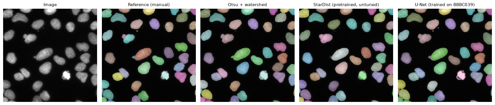

# Nuclei segmentation & quantification — reproducible demo

End-to-end pipeline for instance segmentation of nuclei in 2D fluorescence microscopy,
validated against manual annotations, with per-nucleus measurements and a client-style
report. **Research use only — not for diagnostic use.**

## What you get
- Segmentation masks (one integer label per nucleus, TIFF)
- A table with one row per nucleus: area, position, eccentricity, solidity, mean/max
  intensity (CSV, one per image)
- A validation report (`runs/report.html`, single self-contained file): accuracy against
  the manual reference, examples, failure cases and limitations

## Results on BBBC039 (official test split: 50 images, 5,720 nuclei)

All parameters were chosen on train/val only; the test split was evaluated once at the
end. TP/FP/FN are pooled over all test images. "≥ 25 px" drops objects smaller than
25 pixels from **both** reference and predictions (micronuclei and debris that no method
detects well); "all" is the unfiltered reference.

| Method | Objects | AP@0.5 | AP@0.5:0.95 | F1@0.5 | F1@0.5:0.95 | Mean IoU (matched) |
|---|---|---|---|---|---|---|
| Otsu + watershed (tuned on train) | all | 0.831 | 0.684 | 0.908 | 0.798 | 0.915 |
| | ≥ 25 px | 0.862 | 0.709 | 0.926 | 0.814 | 0.915 |
| StarDist `2D_versatile_fluo` (pretrained, untuned) | all | 0.906 | 0.754 | 0.951 | 0.833 | 0.912 |
| | ≥ 25 px | 0.940 | 0.782 | 0.969 | 0.849 | 0.912 |
| U-Net trained on BBBC039 (from scratch) | all | 0.881 | 0.720 | 0.937 | 0.812 | 0.908 |
| | ≥ 25 px | 0.927 | 0.764 | 0.962 | 0.840 | 0.911 |

AP here is the Data Science Bowl 2018 definition: TP / (TP + FP + FN) at a given IoU
threshold, with one-to-one (Hungarian) matching. AP@0.5:0.95 averages it over IoU
thresholds 0.50, 0.55, …, 0.95, so it rewards precise outlines.

The honest reading:
- **StarDist, pretrained and untuned, is the best method on AP.** Where the methods find a
  nucleus, the outline is equally good (matched IoU ≈ 0.91). The difference is in splitting
  touching nuclei: 82 % of touching nuclei found by StarDist vs. 70 % by Otsu + watershed.
- **The U-Net finds more nuclei but adds more spurious ones.** It was trained from scratch
  on the 100 training images only (PyTorch, 3 classes + watershed, 31 min on a Kaggle GPU;
  model selected on val, where it scored 0.717 AP@0.5:0.95, in line with test).
  - At IoU ≥ 0.5 it misses fewer nuclei than StarDist (337 vs. 487), including 29 % of the
    < 25 px micronuclei (StarDist: 4 %).
  - It also produces more false positives (389 vs. 56; 233 once objects < 25 px are
    dropped), so its AP is lower.
  - Its per-image nucleus count is the closest to the manual one: r = 0.994 and median
    error +1.3 %, against r = 0.989 and −7.2 % for StarDist.
  - Its post-processing was left at its defaults; tuning it on val is the obvious next step.
- **Under simulated blur the U-Net degrades most.** With Gaussian σ = 4 px, AP@0.5:0.95 goes
  0.72 → 0.43 for the U-Net, 0.68 → 0.48 for Otsu and 0.75 → 0.62 for StarDist. A model
  trained on one dataset without blur augmentation does not generalise beyond it.

The value of the service is therefore in validation, quantification and reporting, not in
the segmentation model alone.



*Test image of median difficulty for StarDist, most crowded 256×256 crop. Each instance
is a filled colour; colours are arbitrary and not matched between panels.*

## Limitation: possible train/test overlap for StarDist

StarDist `2D_versatile_fluo` was trained on a subset of the Data Science Bowl 2018
training set (BBBC038 `stage1_train`), which contains fields taken from BBBC039. Names
differ between the two datasets and DSB stores 8-bit PNGs, so `scripts/check_dsb_overlap.py`
searches every DSB image inside every BBBC039 image by normalised cross-correlation.
The result is clear-cut: 43 BBBC039 images match a DSB image with NCC ≥ 0.998, and no
other pair goes above 0.79. **9 of the 50 test images** (and 25 train, 9 val) are in DSB
`stage1_train`. We cannot tell which of them entered StarDist's training subset, so all 9 are
treated as seen and the evaluation is repeated without them:

| Method (all objects) | Test images | AP@0.5 | AP@0.5:0.95 | F1@0.5 |
|---|---|---|---|---|
| Otsu + watershed | 50 | 0.831 | 0.684 | 0.908 |
| | 41 (9 excluded) | 0.828 | 0.682 | 0.906 |
| StarDist (pretrained) | 50 | 0.906 | 0.754 | 0.951 |
| | 41 (9 excluded) | 0.905 | 0.754 | 0.950 |
| U-Net (trained on BBBC039) | 50 | 0.881 | 0.720 | 0.937 |
| | 41 (9 excluded) | 0.876 | 0.718 | 0.934 |

On the 9 overlapping images alone, StarDist scores AP@0.5:0.95 = 0.758, against 0.754 on
the other 41. Otsu + watershed, which never saw DSB, also scores higher on those 9 (0.697),
so they are simply slightly easier images. There is no sign that StarDist's score is
inflated by having seen them. Even so, the decisive check for a client remains a few
annotated images of their own, which no pretrained model has seen.

Other limitations (single cell line and stain, ambiguous reference for fragmented
apoptotic nuclei, simulated blur only, no pixel size) are listed in the report.

## Reproduce

CPU is enough for everything except U-Net training (run on Kaggle, see
`notebooks/train_kaggle.ipynb`).

```
conda create -n bioseg python=3.11 && conda activate bioseg
pip install -e ".[dev,models]"           # add ",train" for the U-Net (PyTorch)
pytest -q

python scripts/download_data.py          # BBBC039 -> data/ (images, labels, official splits)
python scripts/baseline_classical.py tune                    # grid search on train
python scripts/baseline_classical.py predict --split test
python scripts/baseline_pretrained.py --split test           # StarDist, CPU
# U-Net: train on Kaggle, unzip weights into runs/unet/, then
python scripts/predict_unet.py --weights runs/unet/best.pt --split test

curl -o data/external/stage1_train.zip --create-dirs \
     https://data.broadinstitute.org/bbbc/BBBC038/stage1_train.zip
python scripts/check_dsb_overlap.py --dsb-zip data/external/stage1_train.zip  # ~20 min, CPU

python scripts/evaluate.py               # -> runs/results.csv (missing methods: "pending")
                                         #    + results_excl_dsb.csv if the overlap check ran
python scripts/robustness_blur.py --methods otsu stardist   # synthetic blur stress test
python scripts/robustness_blur.py --methods unet            # methods can be run separately; rows are merged
python scripts/quantify.py               # per-nucleus CSVs -> runs/quant/
python scripts/quantify.py --labels data/labels --split test --out runs/quant/reference
python scripts/report.py                 # -> runs/report.html
python scripts/readme_figure.py          # -> docs/figures/example_test.png
```

Every script takes `--help`. Seeds are fixed and the official splits are used throughout.
Data and outputs (`data/`, `runs/`) are not tracked in git.

## Data and licences
BBBC039v1 (CC0): *"We used image set BBBC039v1 Caicedo et al. 2018, available from the
Broad Bioimage Benchmark Collection [Ljosa et al., Nature Methods, 2012]."*
StarDist (Schmidt et al., MICCAI 2018) code and weights: BSD-3-Clause. Cellpose is
deliberately not used (its models are trained on CC-BY-NC data). Details and citations in
[`LICENSES.md`](LICENSES.md).

## Contact
<name> — <email> — custom segmentation and quantification pipelines for research imaging.
